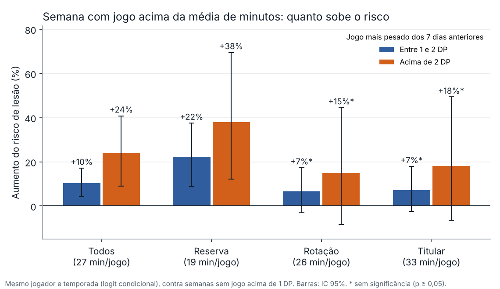
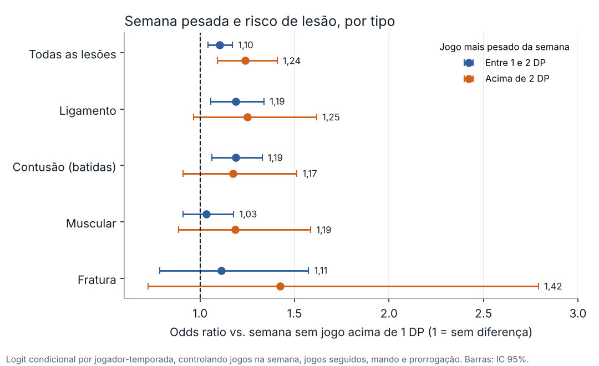
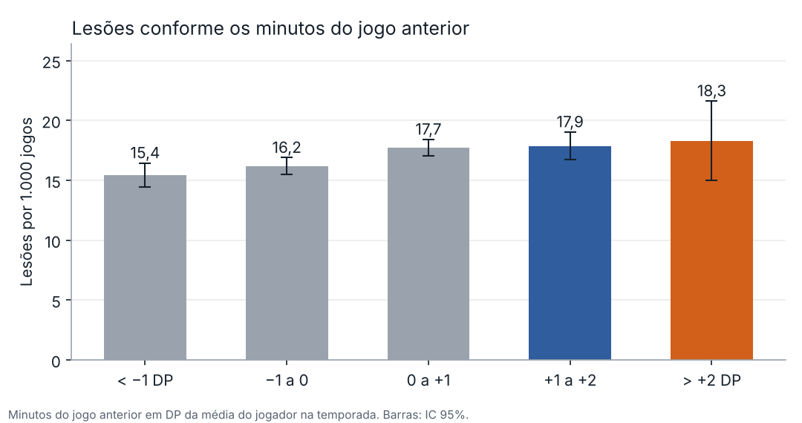

# O que faz um jogador da NBA se lesionar?

Estudo de ciência de dados com 20 temporadas da NBA (2006-07 a 2025-26), cruzando box scores de jogos com os registros da lista de lesionados. O estudo testa seis hipóteses comuns: uso alto, ritmo do time, lesões anteriores, estilo de jogo, defesa física do adversário e carga de minutos.

## Resultados principais

| Hipótese | Resultado | Evidência |
|---|---|---|
| Lesão anterior aumenta o risco no mesmo local | Confirmada | Risco de 4,2% → 16,1% por temporada; odds ratio 2,1 com controles; 67% das recorrências no mesmo lado |
| Semana com minutos acima do normal aumenta o risco | Confirmada | Jogo mais pesado da semana entre 1 e 2 DP acima da média do jogador: +10%; acima de 2 DP: +24%. Nos reservas: +22% e +38% |
| Estilo de jogo muda o risco | Parcial | Pivô de aro +34% e Interno de garrafão +19% vs Arremessador de 3; o estilo muda mais o tipo de lesão |
| Defesa física do adversário | Parcial | Sem efeito no total; musculares +8% e fraturas +19% por desvio-padrão |
| Uso alto (usage rate) | Não sustentada | +0,28 pp de jogos perdidos por ponto de uso, cai para 0,14 (p = 0,19) ao controlar o histórico |
| Times de ritmo rápido | Não sustentada | Correlação bruta 0,52 vem da tendência da liga; dentro da temporada é −0,04 |

## Carga de minutos: quanto uma semana pesada aumenta o risco

Para cada jogo, o estudo olha o jogo mais pesado dos 7 dias anteriores e mede quantos desvios-padrão (DP) os minutos ficaram acima da média do próprio jogador naquela temporada. O jogo da lesão é comparado com os outros jogos do mesmo jogador na mesma temporada (logit condicional). Assim, idade, posição, estilo e histórico ficam constantes. Os controles são jogos na semana, jogos em dias seguidos, mando de quadra e prorrogação.



- **No total:** uma semana com um jogo entre 1 e 2 DP acima da média aumenta o risco de lesão em 10% (IC 95%: 4% a 17%). Acima de 2 DP, o aumento é de 24% (IC: 9% a 41%).
- **O efeito se concentra nos reservas**, que jogam em média 19 minutos: +22% e +38%. São justamente os jogadores menos acostumados a cargas altas. Em rotação e titulares o efeito tem a mesma direção, mas não é significativo.



- **Por tipo de lesão:** o aumento aparece em ligamento (+19%) e em contusões (+19%) já na faixa de 1 a 2 DP. Nas lesões musculares e nas fraturas, as estimativas vão na mesma direção, mas com intervalos largos.



- **Jogo imediatamente anterior:** a incidência sobe de 15,4 para 18,3 lesões por 1.000 jogos conforme os minutos do jogo anterior passam de 1 DP abaixo para 2 DP acima da média.

**Por que a comparação precisa ser dentro do mesmo jogador.** Na taxa bruta, a incidência nas três faixas da semana é praticamente igual: 16,6, 17,0 e 16,3 lesões por 1.000 jogos. Os picos de minutos acontecem mais com reservas, que se lesionam menos por jogo porque ficam menos tempo em quadra. Comparar jogadores diferentes esconde o efeito; comparar cada jogador com ele mesmo revela.

Código: [`03_analises/10_graficos_carga_minutos.py`](03_analises/10_graficos_carga_minutos.py). Números em `04_resultados/carga_minutos_*.csv`.

## Dados

| Fonte | Uso |
|---|---|
| Box scores de jogadores e times (Kaggle, dados da NBA) | Base de jogos: 786.814 linhas de jogadores, 76.046 de times, 30 temporadas |
| Súmulas oficiais da NBA e Basketball-Reference | Correção de divergências: 157 valores corrigidos e 12 jogos incluídos |
| Pro Sports Transactions (três cópias públicas) | 35.180 registros da lista de lesionados de 2006 a 2026 |
| Basketball-Reference (arremesso e avançadas) | Distância dos arremessos, AST%, STL%, BLK%, DRB%, DBPM |

Os dados brutos não estão no repositório; os scripts mostram cada transformação.

## Método

1. **Limpeza** (`01_limpeza/`): remoção de pré-temporada e All-Star, correção pela súmula oficial, conferência de que a soma dos jogadores bate com o total do time em 100% dos jogos, cálculo de estatísticas avançadas.
2. **Variável de lesão** (`02_lesoes/`): ligação dos registros aos jogadores por nome normalizado e tabela de apelidos; montagem de episódios da entrada na lista até a volta (ativação, nova colocação ou primeiro jogo disputado); classificação do motivo em Ligamento, Muscular, Fratura, Contusão ou sem diagnóstico. Validação: 36 de 40 jogos perdidos sorteados confirmados no Basketball-Reference.
3. **Análises** (`03_analises/`):
   - OLS com efeito fixo de temporada e erro agrupado por jogador (uso alto).
   - Spearman bruto e com z-score dentro da temporada (ritmo do time).
   - Logit da recorrência por parte do corpo.
   - K-means (k = 6) sobre dez métricas de estilo padronizadas na temporada + Poisson com exposição em minutos.
   - Logit condicional por jogador-temporada, comparando o jogo da lesão com os outros jogos do mesmo jogador (carga e contato).
4. **Resultados** (`04_resultados/`): planilha com 13 abas, uma por análise, e a metodologia.

## Limitações

- Estudo observacional: associações, não causalidade.
- A data de entrada na lista nem sempre é o dia da lesão.
- O registro de lesões mudou ao longo do tempo; por isso as comparações são feitas dentro da temporada.
- Muitos testes por categoria e parte do corpo; resultados isolados com p entre 0,01 e 0,05 pedem confirmação.

## Próximos passos

- Modelo de sobrevivência (Cox) para o tempo até a próxima lesão.
- Modelo preditivo de risco semanal com validação temporal (AUC e calibração).
- Dados de rastreamento (distância e velocidade) como medida de carga.
- Correção de Benjamini-Hochberg nas análises por categoria.

## Como reproduzir

```bash
pip install -r requirements.txt
# 01_limpeza → 02_lesoes → 03_analises (na ordem numérica)
```

Ferramentas: Python, pandas, NumPy, statsmodels, scikit-learn, SciPy, xlsxwriter.

Autor: Marcus Lima
